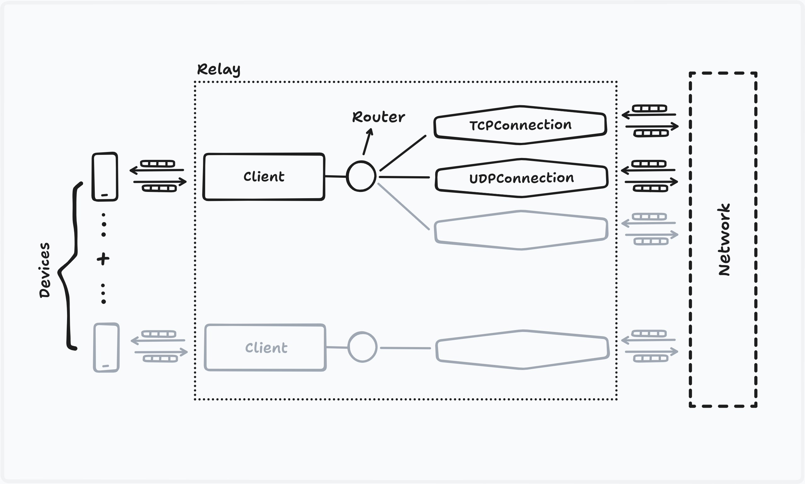

## Gnirehtet for developers

Development activities are mostly performed via `make` with **rules** defined for both the _Java client_ (in `app/`) and the _Rust relay_ (in `relay-rust/`); See, [Makefile](Makefile).

### Requirements

#### 1. For the Android app:

You need the [Android SDK command-line tools](https://developer.android.com/tools#tools-sdk) and [JDK 17+](https://openjdk.org/projects/jdk/). The app still targets Java 8 bytecode, but the compiler must be modern, (`--release 8` flag requires newer version).

- JDK 17+
- Android SDK
  - `platforms;android-36`
  - `build-tools;36.0.0`
  - `platform-tools` in case you don't already have `adb`
- `ANDROID_HOME` or `ANDROID_SDK_ROOT` set to the SDK path. I recommend a `local.env` file containing,

  ```bash
  export ANDROID_HOME="$HOME/android-sdk"
  ```

  which you, then, have to source manually (already gitignored).

- others: `make`, `zip`, `curl`, `keytool` (comes with JDK).

#### 2. For the Rust relay:

You also need the [Rust](https://rust-lang.org/) tooling to build the relay. Install with,

```bash
curl --proto '=https' --tlsv1.2 -sSf https://sh.rustup.rs | sh
```

---

The frequent local loop is,

```bash
source local.env

make app     # compile debug APK (out: app/build/gnirehtet-debug.apk)
make app-gen # generate Java sources
make app-test
make app-lint

make relay # compile debug build (out: relay-rust/target/debug/gnirehtet)
make relay-test
```

### Overview

> **Attribution:** The architecture description below was originally written by
> [Romain Vimont](https://github.com/rom1v), the author of Gnirehtet, and has
> been adapted for the current Rust-only implementation.

The client registers itself as a [VPN], in order to intercept the whole device
network traffic.

It exchanges raw [IPv4 packets] as `byte[]` with the device:

- it receives packets from the Android applications or system;
- it must forge response packets.

The client (executed on the Android device) just maintains a local socket
connection to the relay server, and sends the raw packets to it.

This local socket connection is established over _adb_, after we started a
reverse port redirection:

    adb reverse localabstract:gnirehtet tcp:31416

This means that every connection initiated to the local abstract socket
`gnirehtet` from the device will be redirected to the port `31416` on the
computer, on which the relay server is listening.

The relay server does all the hard work. It receives the IP packets from every
connected client and opens [standard sockets][berkeley] (which, of course, don't
require _root_) accordingly, then relays data in both directions. This requires
to translate packets between level 3 (on the device side) and level 5 (on the
network side) in the [OSI model].

In a sense, the relay server behaves like a [NAT] (more precisely a
[port-restricted cone NAT][portNAT]), in that it opens connections on behalf of
private peers. However, it differs from a standard NAT in the way it
communicates with the clients (the private peers), by using a very specific
(though simple) protocol, over a TCP connection.

[VPN]: https://developer.android.com/reference/android/net/VpnService.html
[IPv4 packets]: https://en.wikipedia.org/wiki/IPv4#Packet_structure
[OSI model]: https://en.wikipedia.org/wiki/OSI_model
[berkeley]: https://en.wikipedia.org/wiki/Berkeley_sockets
[NAT]: https://en.wikipedia.org/wiki/Network_address_translation
[portNAT]: https://en.wikipedia.org/wiki/Network_address_translation#Methods_of_translation

### Client

The client is an _Android_ project located in [`app/`](app/).

The [`VpnService`] is implemented by [`GnirehtetService`].

We control the application through intents to [`GnirehtetActivity`].

Some configuration options may be passed as extra parameters, converted to a
[`VpnConfiguration`] instance. Currently, the user can configure the DNS servers
and routes to use.

The very first time, Android requests to the user the permission to enable the
VPN. In that case, the API requires to call
[`startActivityForResult`], so [`GnirehtetActivity`] handles the authorization
request.

[`RelayTunnel`] manages one connection to the relay server.
[`PersistentRelayTunnel`] manages [`RelayTunnel`] instances to handle
reconnections, so that we can stop and start the relay while the client keeps
running.

To send response packets to the system, we must write one packet at a time to
the VPN interface. Since we receive packets from the relay server over a local
socket connection, we have to split writes at packet boundaries: this is the
purpose of [`IPPacketOutputStream`].

[`VpnService`]: https://developer.android.com/reference/android/net/VpnService.html
[`GnirehtetService`]: app/src/main/java/d3fault/gnirehtet/GnirehtetService.java
[`GnirehtetActivity`]: app/src/main/java/d3fault/gnirehtet/GnirehtetActivity.java
[`VpnConfiguration`]: app/src/main/java/d3fault/gnirehtet/VpnConfiguration.java
[`startActivityForResult`]: https://developer.android.com/reference/android/app/Activity.html#startActivityForResult%28android.content.Intent,%20int%29
[`RelayTunnel`]: app/src/main/java/d3fault/gnirehtet/RelayTunnel.java
[`PersistentRelayTunnel`]: app/src/main/java/d3fault/gnirehtet/PersistentRelayTunnel.java
[`IPPacketOutputStream`]: app/src/main/java/d3fault/gnirehtet/IPPacketOutputStream.java

### Relay server

The relay server is a _Rust_ project located in
[`relay-rust/`](relay-rust/).

It is implemented using [asynchronous I/O] through [Rust mio]. As a consequence,
it is essentially monothreaded, so there is no need for synchronization to
handle packets.

[asynchronous I/O]: https://en.wikipedia.org/wiki/Asynchronous_I/O
[Rust mio]: https://docs.rs/mio/1.2.4/mio/

#### Selector

There are different _socket channels_ registered to a unique _selector_:

- one for the server socket, listening on port 31416;
- one for each _client_, accepted by the server socket;
- one for each _TCP connection_ to the network;
- one for each _UDP connection_ to the network.

Initially, only the server socket _channel_ is registered.

In **Rust**, our own [`Selector`][rust/selector] class wraps the
[`Poll`][mio/Poll] from _mio_ to expose an API accepting event handlers instead
of low-level [tokens][mio/Token]. The _selector_ instance is created in
[`Relay`][rust/relay]. The _channels_ are called _event sources_ in _mio_; they
are simply the socket instances themselves ([`TcpListener`][mio/TcpListener],
[`TcpStream`][mio/TcpStream] and [`UdpSocket`][mio/UdpSocket]). A
[`Client`][rust/client] is created for every accepted _client_.

[mio/Poll]: https://docs.rs/mio/1.2.4/mio/struct.Poll.html
[mio/Token]: https://docs.rs/mio/1.2.4/mio/struct.Token.html
[mio/TcpListener]: https://docs.rs/mio/1.2.4/mio/net/struct.TcpListener.html
[mio/TcpStream]: https://docs.rs/mio/1.2.4/mio/net/struct.TcpStream.html
[mio/UdpSocket]: https://docs.rs/mio/1.2.4/mio/net/struct.UdpSocket.html
[rust/selector]: relay-rust/src/relay/selector.rs
[rust/relay]: relay-rust/src/relay/relay.rs
[rust/client]: relay-rust/src/relay/client.rs



#### Client

Each _client_ manages a TCP socket, used to transmit raw IP packets from and to
the _Gnirehtet_ Android client. Thus, these IP packets are encapsulated into TCP
(they are transmitted as the TCP payload).

When a client connects, the relay server assigns an integer id to it, which it
writes to the TCP socket. The client considers itself connected to the relay
server only once it has received this number. This allows to detect any
end-to-end connection issue immediately. For instance, a local socket _connect_
initiated by a client succeeds whenever a port redirection is enabled (typically
through `adb reverse`), even if the relay server is not listening. In that case,
the first _read_ will fail.

#### Packets

A class representing an _IPv4 packet_ ([`Ipv4Packet`][rust/ipv4-packet]) provides
a structured view to read and write packet data, which is physically stored in
the buffers (the little squares on the schema). Since we handle one packet at a
time with asynchronous I/O, there is no need to copy or synchronize access to
the packets data: the packets just point to the buffer where they are stored.

[rust/ipv4-packet]: relay-rust/src/relay/ipv4_packet.rs

Each packet contains an instance of _IPv4 headers_ and _transport headers_
(which might be _TCP_ or _UDP_ headers).

In **Rust**, the borrowing rules prevent to share a mutable reference.
Therefore, _header data_ classes (`*HeaderData`) are used to store the fields,
and lifetime-bound views (`*Header<'a>` and `*HeaderMut<'a>`) reference both
the raw array and the _header data_:

- [`ipv4_header`][rust/ipv4-header]:
  - data: `Ipv4HeaderData`
  - view: `Ipv4Header<'a>`
  - mutable view: `Ipv4HeaderMut<'a>`
- [`tcp_header`][rust/tcp-header]:
  - data: `TcpHeaderData`
  - view: `TcpHeader<'a>`
  - mutable view: `TcpHeaderMut<'a>`
- [`udp_header`][rust/udp-header]:
  - data: `UdpHeaderData`
  - view: `UdpHeader<'a>`
  - mutable view: `UdpHeaderMut<'a>`

In addition, we use [enums][rust-enums] for _transport headers_ to statically
dispatch calls to _UDP_ and _TCP_ header classes:

- [`transport_header`][rust/transport-header]:
  - data: `TransportHeaderData`
  - view: `TransportHeader<'a>`
  - mutable view: `TransportHeaderMut<'a>`

[rust/ipv4-header]: relay-rust/src/relay/ipv4_header.rs
[rust/tcp-header]: relay-rust/src/relay/tcp_header.rs
[rust/udp-header]: relay-rust/src/relay/udp_header.rs
[rust/transport-header]: relay-rust/src/relay/transport_header.rs
[rust-enums]: https://doc.rust-lang.org/book/first-edition/enums.html

#### Router

Each _client_ holds a _router_ ([`Router`][rust/router]), responsible for sending
the packets to the right _connection_, identified by these 5 properties
available in the IP and transport headers:

- protocol
- source address
- source port
- destination address
- destination port

These identifiers are stored in a _connection id_
([`ConnectionId`][rust/connection]), used as a key to find or create the
associated _connection_.

[rust/router]: relay-rust/src/relay/router.rs

#### Connections

A _connection_ ([`Connection`][rust/connection]) is either a _TCP connection_
([`TcpConnection`][rust/tcp-connection]) or a _UDP connection_
([`UdpConnection`][rust/udp-connection]) to the requested destination. It
registers its own _channel_ to the _selector_.

[rust/connection]: relay-rust/src/relay/connection.rs
[rust/tcp-connection]: relay-rust/src/relay/tcp_connection.rs
[rust/udp-connection]: relay-rust/src/relay/udp_connection.rs

The connection is responsible for converting data from level 3 to level 5 for
device-to-network packets, and from level 5 to level 3 for network-to-device
packets. For _UDP connections_, it consists essentially in removing or
adding IP and transport headers. For _TCP connections_, however, it
requires to respond to the client according to the TCP protocol ([RFC 793]),
in such a way as to ensure a correct end-to-end communication.

[RFC 793]: https://tools.ietf.org/html/rfc793

A _packetizer_ ([`Packetizer`][rust/packetizer]) converts from level 5 to level 3
by appending correct IP and transport headers.

[rust/packetizer]: relay-rust/src/relay/packetizer.rs

##### UDP connection

When the first packet for a specific UDP connection is received from the device,
a new `UdpConnection` is created. It keeps a copy of the IP and UDP headers
of this first packet, swapping the source and the destination, in order to use
them as headers for all response packets.

The relaying is simple for UDP: each packet received from one side must be sent
to the other side, without any splitting or merging (datagram boundaries must be
preserved for UDP).

Since UDP is not a connected protocol, a UDP connection is never "closed".
Therefore, the _selector_ wakes up once per minute (using a timeout) to clean
expired (in practice, unused for more than 2 minutes) UDP connections.

##### TCP connection

`TcpConnection` also keeps, as a reference, a copy of the IP and TCP headers
of the first packet received.

However, contrary to UDP, TCP must provide reliable delivery. In particular,
lost packets have to be retransmitted. Nonetheless, we can take advantage of the
two TCP we are proxifying, so that we can provide reliability by delegating the
retransmission mechanism to them. In fact, it is sufficient to guarantee that
**we cannot lose packets from network to device**.

Indeed, any packet written to a TCP channel is safe, since it will be managed by
the TCP implementation from the system. Losing a raw IP packet received from the
device is also safe: the device TCP implementation will follow the TCP protocol
to retransmit it. Therefore, **dropping packets from device to network does not
break the connection**.

On the other hand, once we retrieved a packet from a TCP channel from the
network, we are responsible for it. Would it be dropped, there would be no way
to recover the connection.

As far as I know, there are only two possible causes of packet loss for which we
are responsible:

1.  When **our buffers are full**, we won't resize them indefinitely, so we have to
    drop packets. Typically, this may happen if the data from the network is
    received at a higher rate than that they can be sent to the device.

2.  When **a raw packet is considered invalid** by the device, it is rejected.
    This may happen for example if the checksum is invalid or if the TCP sequence
    number is [out-of-the-window][flow control].

[flow control]: https://en.wikipedia.org/wiki/Transmission_Control_Protocol#Flow_control

Therefore, by [contraposition], if we guarantee that we never retrieve a packet
that we won't be able to store, and that we provide a valid checksum and respect
the client TCP window, then **we won't lose any packet without implementing any
retransmission mechanism**.

[contraposition]: https://en.wikipedia.org/wiki/Contraposition

To prevent retrieving a packet while our buffers are full, we indicate that we
are not interested in reading ([`Interest`][mio/interest]) the TCP channel when
some pending data remain to be written to the client buffer. Once some space
becomes available, the client then _pulls_ the available packets from the
`TcpConnection`s, which are _packet sources_
([`PacketSource`][rust/packet-source]).

[mio/interest]: https://docs.rs/mio/1.2.4/mio/struct.Interest.html
[rust/packet-source]: relay-rust/src/relay/packet_source.rs

### Hack

For more details, go read the code!

If you find a bug, or have an awesome idea to implement, please discuss and
contribute ;-)
